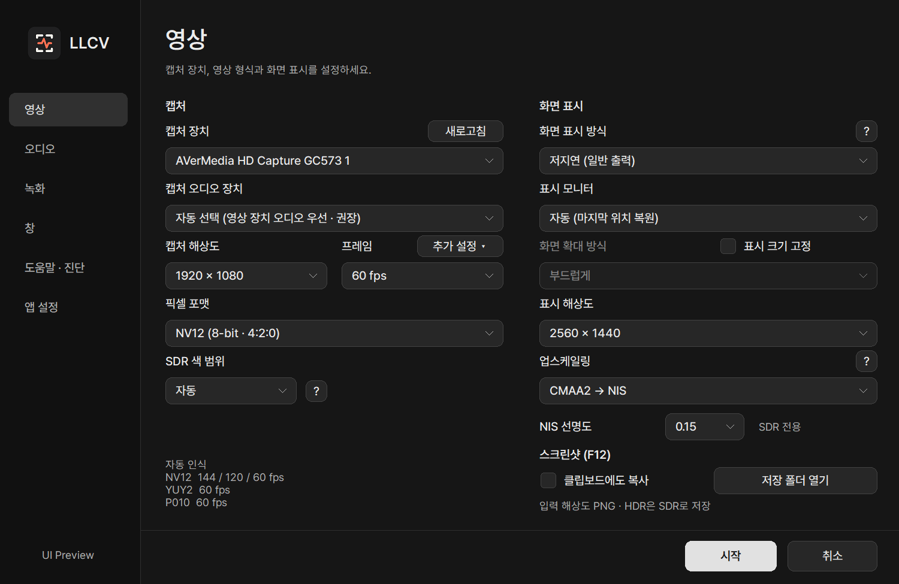
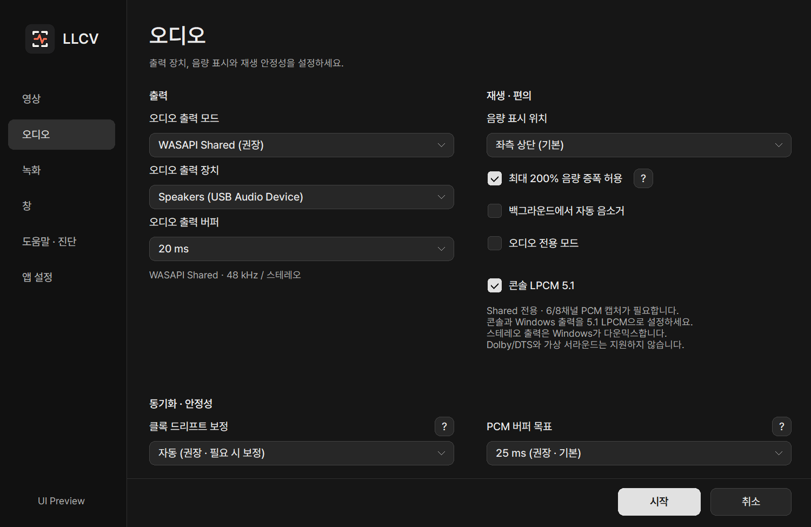

# LLCV - Low Latency Capture Viewer

HDMI 캡처보드로 들어오는 영상과 소리를 재생하는 Windows용 저지연 뷰어입니다.
OBS 없이 콘솔 게임 화면을 보거나, 오디오 전용 모드로 소리만 들을 수 있습니다.

**[다운로드](https://github.com/seria-aa/LowLatencyCaptureViewer/releases/latest)** · [사용 가이드](docs/USAGE.ko.md) · [변경 내역](docs/release-notes-v2.3.2.md) · [English](README.en.md)

 

| 영상 설정 | 오디오 설정 |
| --- | --- |
|  |  |

2.1.6 UI 예시입니다. 장치 목록과 지원 형식은 환경에 따라 다릅니다. 이미지를 누르면 원본 크기로 볼 수 있습니다.

 

## 2.3.2 업데이트

설정의 **영상 → 화면 표시**에서 재생 그래픽카드를 직접 고를 수 있습니다. 자동은 외장 그래픽을 우선합니다. 내장·외장 그래픽을 함께 쓰는 PC에서도 Windows 설정을 바꾸지 않고 VFG 호환 GPU를 선택할 수 있습니다.

## 2.3.1 업데이트

F2로 설정을 열거나 앱을 다시 실행해도 VFG 사용 여부와 품질 설정을 기억합니다. F7로 끄거나 켠 상태도 사용 체크와 별도로 유지됩니다.

## 2.3.0 업데이트

캡처 영상에 **NVIDIA VFG 프레임 보간**을 선택해 사용할 수 있습니다. Ada·Blackwell은 기본 경로를, RTX 30(SM 8.6)은 지정 런타임에서 실험적 호환 경로를 사용합니다. 기본은 꺼짐이며, NVIDIA 실행 구성품과 모델은 동봉하지 않습니다.
녹화 중에는 화면 구석에 **REC와 경과 시간**이 표시되고, 정상 저장한 MP4의 길이는 Windows 탐색기에 표시됩니다.
캡처 오디오를 연결하지 못하면 영상만 시작할 수 있고, F1에서는 지정된 단축키 전체를 확인할 수 있습니다.
[전체 변경 내역](docs/release-notes-v2.3.0.md) · [프레임 보간 안내](docs/FRAME_INTERPOLATION.ko.md)

 

## OBS 대비 화면 표시 지연

LLCV 2.3.0 기반 계측 빌드에서 **프레임 보간을 켠 상태**로 측정한 예입니다. 2.3.2에서 새로 측정한 값은 아닙니다.

| 표시 방식 (프레임) | 원본 표시 평균 | OBS 전체화면 대비 |
| --- | ---: | ---: |
| OBS 전체화면 프로젝터 (60) | 43.5 ms | 기준 |
| LLCV 저지연 · VFG 낮음 (60 → 120) | 45.1 ms | +1.5 ms |
| LLCV 저지연 · VFG 중간 (60 → 120) | 47.9 ms | +4.4 ms |
| LLCV 독점 전체화면 · VFG 낮음 (60 → 120) | 29.9 ms | −13.6 ms |
| LLCV 독점 전체화면 · VFG 중간 (60 → 120) | 32.5 ms | −11.0 ms |

GC573 · RTX 3080 · FHD 60fps NV12 SDR 캡처 · 4K 144Hz 모니터 · OBS 32.2.2. 조건별 2회 측정했으며 OBS 전체화면은 별도 회차에서 측정했습니다. 소스 프레임이 표시된 시점부터 같은 원본 프레임이 뷰어에 표시된 시점까지의 평균입니다. 버튼 입력 지연이 아니며, 120fps는 보간 목표입니다. 차이는 반올림 전 평균으로 계산했습니다.

 

## 설치 및 실행

Windows 10/11 x64와 캡처보드 드라이버가 필요합니다.
별도 코덱 팩·Visual C++ 재배포 패키지는 설치하지 않아도 됩니다.
녹화에 필요한 FFmpeg 저장 라이브러리는 배포본에 포함되어 있습니다.

[최신 릴리스](https://github.com/seria-aa/LowLatencyCaptureViewer/releases/latest)에서 **Setup.exe**로 끝나는 설치 파일을 받으세요.
설치 없이 쓰려면 **x64.zip**을 풀고 `LowLatencyCaptureViewer.exe`를 실행하면 됩니다.

1. OBS 등 캡처보드를 사용 중인 다른 프로그램을 종료합니다.
2. LLCV에서 **캡처 장치**를 확인하고 **시작**을 누릅니다.
3. 소리가 나오지 않으면 **캡처 오디오 장치**를 확인하세요.

<kbd>F1</kbd> 도움말 · <kbd>F2</kbd> 설정 · <kbd>F6</kbd> 업스케일링 · <kbd>F9</kbd> 녹화 · <kbd>F11</kbd> 전체화면 · <kbd>F12</kbd> 스크린샷 · <kbd>Tab</kbd> 진단

위 키는 기본값이며, **도움말·진단**에서 변경할 수 있습니다.

 

## 지원 기능

- 최신 프레임 우선 표시, 저지연 출력(일반·독점 전체화면)과 VSync
- NV12/YUY2/UYVY(HDYC), MJPEG, P010 HDR10 입력 — UYVY/HDYC는 재생·스크린샷 지원, 녹화 제외
- 장치가 제공하는 RGB24·XRGB (RGB32) SDR 재생·원본 스크린샷·VSR 요청·녹화 — 직접 선택
- 선택적 40fps 캡처 및 목록에 없는 30fps 직접 요청 — 드라이버 수락 필요
- SDR 색 범위 자동/Limited/Full — 재생·스크린샷·녹화에 공통 적용
- NVIDIA VSR (실험적), 캡처·표시 해상도 개별 설정 또는 연동
- 업스케일링: SDR은 CMAA2 → NIS(높음/보존형), HDR10은 NIS+윤곽 보호. 끄기/VSR 선택, 선명도 기본 0.15
- WASAPI Shared·Exclusive, ASIO, 콘솔 LPCM 5.1, 오디오 전용 모드
- NV12/YUY2/MJPEG/RGB SDR·스테레오 MP4 녹화 — 코덱·품질·음량, 일시정지, 자동 분할
- 입력 해상도 PNG 스크린샷과 클립보드 복사
- 진단자료 ZIP 만들기 — 로그·설정 수집, 일부 개인정보 가림, 자동 전송 없음
- 재생 중 자동 절전 방지 — 오디오 전용 모드에서는 화면 꺼짐 허용
- 다크·라이트 테마, 전체화면, 창 크기 고정, 음량 조절·재생 음소거, 한국어·영어

HDR10은 호환 장치와 HDR 디스플레이가, ASIO는 전용 드라이버가 필요합니다.
LPCM 5.1은 다채널 캡처·Shared 출력 전용입니다.

VSR 동작은 GPU·드라이버에 따라 다르며 지연이 늘 수 있습니다. HDR 스크린샷은 SDR로 저장됩니다.
[기능별 지원 조건](docs/USAGE.ko.md#호환성-및-사용-조건)을 확인하세요.

 

## 문서

[전체 문서 목록](docs/INDEX.ko.md)에서 릴리스 노트와 개발·검증 기록도 확인할 수 있습니다.

- [사용 가이드](docs/USAGE.ko.md) — 설정, 단축키, 업스케일링·VSR, 스크린샷, 절전 방지
- [녹화](docs/RECORDING.ko.md) — 지원 조건, 품질·용량, 분할·파일 보호
- [영상·HDR](docs/VIDEO.ko.md) / [오디오·5.1](docs/AUDIO.ko.md)
- [문제 해결](docs/TROUBLESHOOTING.ko.md) / [진단·로그](docs/DIAGNOSTICS.ko.md) / [소스 빌드](docs/BUILDING.ko.md)

Linux용은 별도로 관리되는 [LLCV for Linux](https://github.com/Meo-Hong/LLCV-for-Linux) 포크를 확인하세요.
설치 방법과 지원 범위, 문의는 해당 저장소에서 안내합니다.

---

Copyright (C) 2026 seria-aa. [GNU GPL v3.0 또는 이후 버전](LICENSE).
