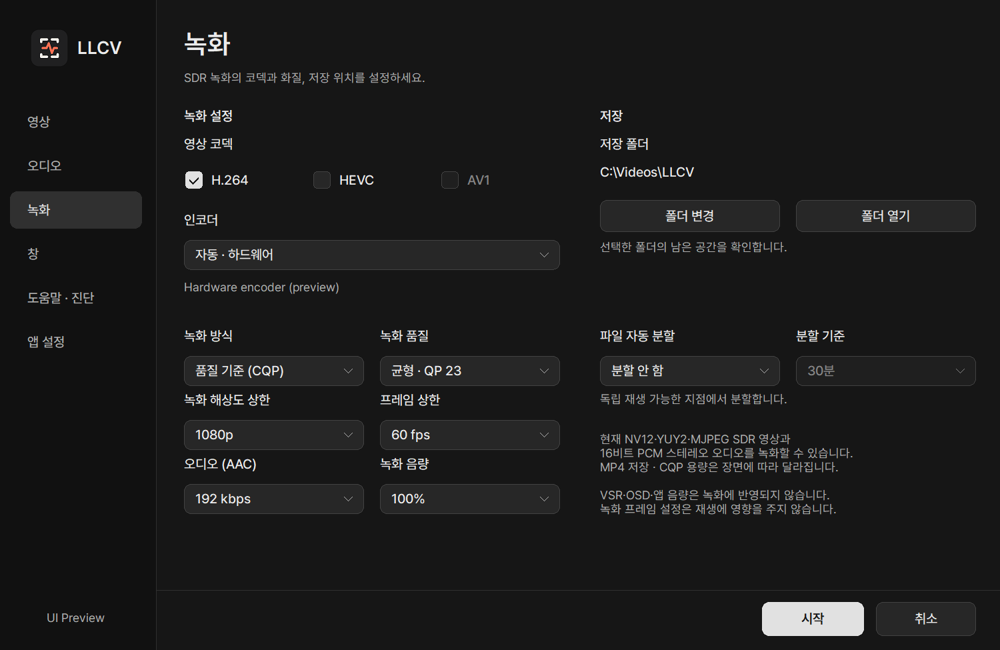

# 녹화

[README](../README.md) · [문서 목록](INDEX.ko.md) · [English](RECORDING.md)

NV12·YUY2·MJPEG·RGB SDR 영상과 16비트 PCM 스테레오 입력을 MP4로 저장합니다.
MJPEG 입력은 녹화 작업 스레드에서 디코딩한 뒤 선택한 H.264·HEVC·AV1 인코더로 저장합니다.
MJPEG 녹화는 디코딩을 추가로 수행하므로 CPU 사용량이 늘 수 있습니다.
녹화는 재생·스크린샷과 같은 색 해석을 사용합니다. **영상 → SDR 색 범위**는 모든 SDR 입력에,
**MJPEG 색 공간**은 MJPEG에만 적용하며 기본값은 자동입니다.
현재 HDR·5.1·오디오 전용 녹화는 지원하지 않습니다. 재생 지원 범위와는 다릅니다.
UYVY/HDYC도 재생·스크린샷만 지원하며, 녹화 시작 시 안내합니다. 녹화하려면 장치가 제공하는 NV12·YUY2·MJPEG를 선택하세요.

RGB24·XRGB (RGB32) SDR 입력도 녹화합니다. 작업 스레드에서
BT.709 Limited NV12(4:2:0)로 변환하며 녹화 해상도를 낮추면 축소를 함께 처리합니다.
SDR 색 범위와 원본 방향을 반영하고, 재생·PNG 원본·VSR·OSD와는 분리합니다.
CPU 사용량과 입력 복사량은 늘어날 수 있습니다. 고해상도에서는 녹화 해상도·프레임 상한을 낮춰주세요.
RGB 녹화는 파일을 만들기 전에 작업 스레드에서 선택한 변환 경로의 속도를 확인합니다.
프레임 처리 여유가 부족하면 시작하지 않고 녹화 해상도·프레임 상한 조정을 안내합니다.
사용자가 고른 FPS를 자동으로 낮추지는 않으며, 짧은 사전 검사가 장시간 처리 속도를 보장하지는 않습니다.
RGB 원본·변환 프레임 버퍼는 각각 최대 128 MiB·192 MiB(각 최대 16개)로 제한합니다.
4K RGB32 입력의 해당 버퍼 합계는 원본 크기 녹화 시 약 316 MiB, 기본 1080p 녹화 시 약 174 MiB입니다.
오디오·인코더·GPU 메모리는 별도입니다.

2.1.6 UI 코드로 렌더링한 예시입니다. 인코더 지원 여부는 사용 환경에 따라 다릅니다.

 

## 시작과 종료

1. **녹화** 탭에서 저장 폴더와 코덱·품질을 확인합니다.
2. SDR 영상과 스테레오 소리를 재생한 뒤 **F9**를 눌러 녹화를 시작합니다. 다시 누르면 저장을 마무리합니다.
3. **폴더 열기**로 결과를 확인합니다. 화면에 **마무리 중**이 표시될 때는 완료될 때까지 기다리세요.

**F2**는 녹화 탭이 아닌 기본 설정을 엽니다. 녹화 중이거나 일시정지 상태라면 먼저 녹화를 마무리할지
확인하며, **아니오**를 누르면 재생과 녹화 상태를 유지합니다.
재생을 유지하면서 일시정지·재개하려면 화면 구석의 녹화 상태 표시를 눌러 녹화 설정을 여세요.

녹화 탭을 처음 열면 인코더 지원 여부를 확인합니다. 확인이 끝나면 지원되는 코덱과 녹화 방식을 선택할 수 있으며, 확인 중에도 설정 창을 닫을 수 있습니다.
**인코더 확인을 완료하지 못했습니다**는 검사 실패 안내이지 코덱 미지원 판정이 아닙니다. 설정 창을 닫았다가 다시 열어 재시도하세요.

F9는 기본값입니다. **도움말·진단**에서 변경할 수 있고, 기존 설정에서 F9를 다른 기능에 쓰고 있었다면 비어 있는 기능키가 배정됩니다. 실제 지정 키를 확인하세요.
설정 창에서는 **F4를 제외한 기능키(F1~F24)** 또는 해당 키의 Ctrl·Alt·Shift 조합에 지정한 녹화 단축키만 작동합니다. 다른 지정 키는 재생 창에서 그대로 사용할 수 있고, 설정 창에서는 원래 입력·이동 동작을 유지합니다.
녹화 중에는 설정의 녹화 탭에서 일시정지·재개할 수 있습니다. 쉬는 구간은 파일 시간에서 제외되며 게임 화면과 소리는 계속 재생됩니다.
녹화 시작·재개 지점 이전의 소리만 잘라내고 이후 구간은 저장합니다.
화면 구석 상태 표시와 OSD는 녹화 파일에 들어가지 않습니다.

 

## 화질과 용량

기본값은 **H.264 · 자동 하드웨어 · 품질 기준(CQP) · 균형(QP 23)**, **1080p·60fps 상한**, AAC 192kbps, 녹화 음량 100%, 분할 안 함입니다. 입력이 더 낮으면 그대로 녹화하며, 이미 저장한 녹화 설정은 유지합니다.

| 설정 | 동작 |
| --- | --- |
| H.264 / HEVC / AV1 | 설치된 인코더와 저장 경로에서 지원이 확인된 항목만 사용합니다. 코덱 지원 여부가 모든 해상도·프레임의 실시간 녹화를 보장하지는 않습니다. |
| 인코더 | 자동 하드웨어 또는 지원되는 CPU 인코더를 선택합니다. 별도 CPU AV1 인코더는 포함하지 않습니다. |
| 품질 기준(CQP) | 용량 절약(QP 26) / 균형(QP 23) / 높은 화질(QP 20). 장면에 따라 용량이 달라지며, 코덱·제조사 사이에 같은 QP가 같은 화질을 뜻하지는 않습니다. |
| 비트레이트 지정 | 영상 2~100Mbps, 오디오 128/192kbps. 실제 용량은 인코더 동작과 파일 구조에 따라 달라집니다. |
| 해상도·프레임 상한 | 입력 유지 또는 1440p/1080p/720p, 60/30fps. 입력보다 높이지 않으며 재생 화면의 해상도·프레임은 바꾸지 않습니다. |
| 자동 분할 | 끔 / 시간(15·30·60·120분) / 용량(1·2·4·8·16GiB). 독립 재생 가능한 지점까지 기다리므로 지정값을 조금 넘을 수 있습니다. |

**녹화 탭 → 오디오(AAC) 옆의 녹화 음량**에서 녹화 시작 전에 0~100%로 조절합니다. 기본값은 100%, 0%는 무음이며 재생 음량과 별도로 저장됩니다.
CMAA2 → NIS·VSR, 앱의 확대·배치, OSD, 스크린샷 효과와 재생 음량 조절·음소거는 녹화에 반영하지 않습니다.
인코더가 선택한 조합을 거부하면 다른 코덱이나 CPU로 몰래 바꾸지 않고 안내합니다.
재생이나 녹화가 버거우면 먼저 녹화 해상도·프레임 상한을 낮추세요.

 

## 저장과 파일 보호

기본 저장 위치는 Windows **동영상 → LLCV**입니다. 설정에서 다른 폴더를 선택할 수 있습니다.
녹화 중에도 남은 공간을 갱신합니다. 표시된 폴더의 공간을 확인할 수 없으면 0이 아닌 확인 불가로 안내합니다.
공간 조회는 기존 저장 스레드에서 비동기로 처리해 인코딩이 조회 완료를 기다리지 않도록 합니다. 갱신에는 지연이 있을 수 있으며, 마무리용 여유 공간 확보와 실제 쓰기 오류 감지는 유지합니다.
저장장치가 오래 멈추면 제한된 대기열을 초과하거나 마무리가 지연될 수 있습니다.
저장 공간 부족·쓰기 실패·인코딩 과부하는 안내하고 녹화를 중단하지만 재생은 유지합니다.
녹화 중 앱을 닫으면 확인 후 파일 저장을 마치고 종료합니다. 저장이 지연되면 안내를 확인하고, 강제 종료 시 마지막 구간을 잃을 수 있다는 점에 주의하세요.

H.264·HEVC·AV1 모두 조각화 MP4를 사용합니다. 갑작스러운 종료 뒤에는 이미 기록된 조각이 남을 수 있지만, 마지막 조각·OS 저장 캐시·디스크 오류까지 보호하지는 못합니다. 파일을 보관하고 호환되는 플레이어에서 확인하세요. 자동 복구나 무손실 보장은 아닙니다.

재생 기본 설정은 기존 위치에 유지하며 녹화 설정은 별도 파일로 저장합니다. 시제품 사용자의 설정을 보존하기 위해 내부 파일명 `recording-prototype.ini`도 유지합니다. 설치 폴더를 복사해도 같은 Windows 계정에서는 설정을 공유합니다.

---

[사용 가이드](USAGE.ko.md) · [문제 해결](TROUBLESHOOTING.ko.md) · [English](RECORDING.md)
