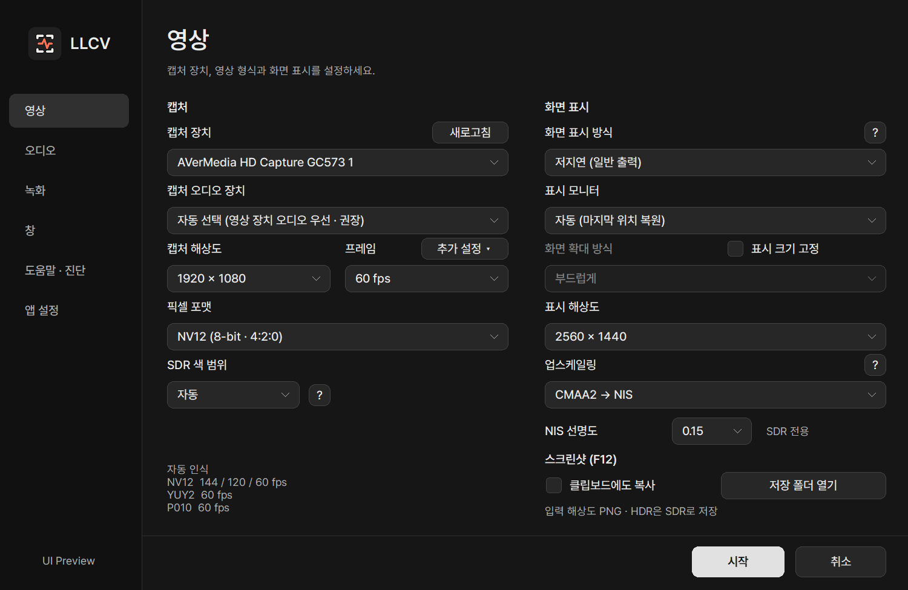
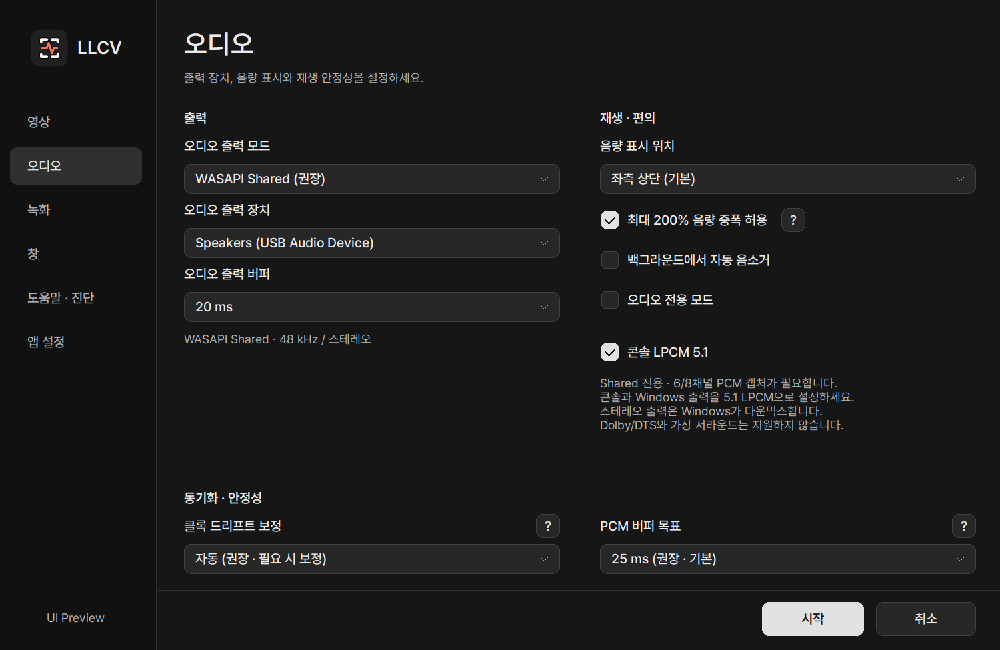
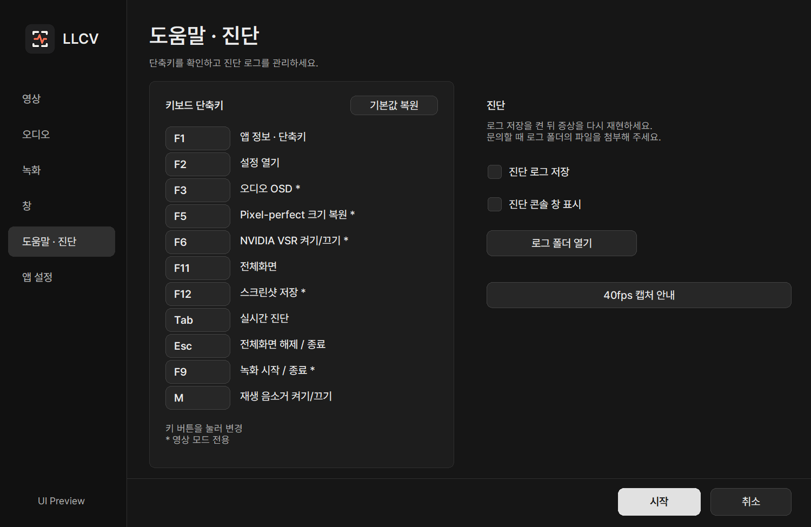

# LLCV 사용 가이드

[README](../README.ko.md) · [문서 목록](INDEX.ko.md) · [English](USAGE.md)

[다운로드](#다운로드) · [처음 사용하기](#처음-사용하기) · [설정 찾기](#설정-찾기) · [무엇을 고르면 되나요?](#무엇을-고르면-되나요) · [단축키 변경](#단축키-변경) · [자주 쓰는 기능](#자주-쓰는-기능) · [NVIDIA VSR (실험적)](#nvidia-vsr-실험적) · [스크린샷](#스크린샷) · [문제 해결](#문제-해결) · [호환성 및 사용 조건](#호환성-및-사용-조건)

 

## 다운로드

[최신 릴리스](https://github.com/seria-aa/LowLatencyCaptureViewer/releases/latest)에서 둘 중 하나를 받으세요.

- **Setup.exe — 권장:** 설치와 제거 프로그램을 제공합니다. 시작 메뉴 바로가기는
  자동으로 생성하며, 바탕화면 바로가기는 설치 중 선택할 수 있습니다.
- **x64.zip — 포터블:** 압축을 푼 뒤 `LowLatencyCaptureViewer.exe`를 실행합니다.

**2.1.5 업데이트:** FPS 직접 선택 검증, SDR 색 범위와 캡처 해상도 연동 표시를 추가·보완했습니다.
프레임 옆 **추가 설정**에서 선택적 FPS 요청을 변경합니다. F2는 계속 기본 설정을 엽니다.
기존 설치 경로·설정·사용자 지정 단축키는 유지합니다.
[녹화 안내](RECORDING.ko.md) · [2.1.5 릴리스 노트](release-notes-v2.1.5.md)
[2.0.4](release-notes-v2.0.4.md)에 추가한 **40fps 캡처**는 기본 꺼짐이며,
필요한 경우에만 **영상 → 프레임 옆 추가 설정**에서 켜세요.
절전 방지·설정 화면 개선 기록은 [2.0.3 릴리스 노트](release-notes-v2.0.3.md)에 있습니다.
이전 2.0.2 설치파일만 갱신한 기록은 [2.0.2 릴리스 노트](release-notes-v2.0.2.md)에 있습니다.

Windows 10/11 x64와 캡처보드 드라이버가 필요합니다.

 

## 처음 사용하기

1. OBS, 제조사 캡처 유틸리티 등 캡처보드를 열어 둔 프로그램을 모두 종료합니다.
2. 앱을 실행합니다.
3. **캡처 장치**가 맞는지 확인하고 **시작**을 누릅니다.

처음에는 기본값 그대로 사용해도 됩니다. 기본값은 1080p, 저지연 표시, WASAPI
Shared, PCM 버퍼 25ms, 자동 클록 보정입니다. 이전 버전에서 저장한 PCM 버퍼가
20ms라면 처음 실행할 때 한 번만 25ms로 올리며, 다른 저장값은 유지합니다.
변경 후 원하면 20ms를 다시 선택할 수 있습니다.
이미 이 갱신을 거친 설정은 업데이트해도 다시 변경하지 않습니다.

영상은 나오는데 소리가 없으면 **캡처 오디오 장치**를 확인하세요. USB 캡처보드처럼
영상과 오디오가 별도 장치로 표시되는 경우에는 같은 이름의 오디오 장치를 직접
선택해야 합니다. “영상 장치 내부 오디오 감지됨 · 자동 사용”이라고 보이면 따로
선택할 필요가 없습니다.

 

## 설정 찾기

재생 창에서 **F2**를 누르면 **영상·창**, 오디오 전용 모드에서는 **오디오** 설정으로 돌아갑니다.
녹화 옵션은 **녹화** 탭에서 선택하세요. 녹화 중이거나 일시정지 상태라면 녹화를 마무리할지
먼저 확인합니다. **예**는 저장을 마친 뒤 기본 설정으로 이동하고, **아니오**는 재생과 현재 녹화 상태를 유지합니다.

*아래 설정 이미지는 2.1.3 UI 코드로 직접 그린 예시입니다. 선택값은 예시이며, 장치 목록과 지원 포맷·프레임은 사용 환경에 따라 달라집니다.*

| 영상 설정 | 오디오 설정 |
| --- | --- |
|  |  |

### 앱 정보·단축키 (기본: F1)

앱 정보·단축키 화면 보기

사이드바는 **영상 · 오디오 · 녹화 · 창 · 도움말·진단 · 앱 설정**으로 나뉩니다.
영상에는 캡처·화면 표시와 VSR·스크린샷 옵션이 있습니다. 목록에 없는 FPS 요청과
40fps 캡처는 **프레임 옆 추가 설정**에서 변경합니다.
오디오에는 출력 장치·버퍼·음량·오디오 전용 모드·LPCM 5.1을 모았습니다.
녹화에는 코덱·품질·해상도·프레임 상한·AAC·녹화 음량·분할·저장 폴더를 모았습니다. [녹화 안내](RECORDING.ko.md)를 확인하세요.
창에서는 위치·크기·테두리·커서 동작과 전체화면 영상 위치를 설정합니다.
도움말·진단에서는 단축키 변경·복원, 40fps 캡처 안내와 로그를, 앱 설정에서는 언어·테마·시작·절전 방지·업데이트 설정을 확인하세요.

작은 화면이나 높은 표시 배율에서는 설정을 화면 안에 맞추고, 공간이 부족하면
상단의 항목 선택 목록으로 페이지를 나눠 표시합니다. 스크롤 없이 모든 항목을 선택할 수 있습니다.

**앱 설정 → 앱 테마**에서 다크·라이트를 고를 수 있습니다. 설정 창·F1 안내창·오디오
전용 화면에 공통 테마를 적용하며, 영상 위 OSD는 영상과 구분되도록 어두운 색상을 유지합니다.

지원 포맷·프레임, 내부 캡처 오디오와 WASAPI Shared 지원 정보는 백그라운드에서
조회하고, 같은 설정 창 안에서는 조회 결과를 재사용합니다.
다시 확인하려면 **새로고침**을 누르세요. 필요한 영상 정보를 조회 중이거나 조회에 실패한
동안에는 시작할 수 없습니다.
장치 연결을 바꾼 뒤에도 이전 정보가 보이면 새로고침 후 선택을 확인하세요.
WASAPI와 ASIO를 오가도 각 모드의 출력 장치와 유효한 버퍼 선택을 유지합니다.

**앱 설정 → 재생 중 자동 절전 방지**는 기본으로 켜져 있습니다. 영상 재생 중에는
화면 꺼짐과 자동 절전을 막고, 오디오 전용 모드에서는 화면 꺼짐을 허용합니다.
재생 종료·장치 오류·앱 종료 시 요청을 해제하며, 설정 화면만 열려 있을 때는 적용하지 않습니다.
사용자가 직접 선택한 절전·덮개 닫기와 Windows 전원 정책은 존중합니다.
절전 후 사용자가 돌아와 재생이 이어지는 경우에만 다시 적용하며, 자동으로 깨어난 경우에는 재요청하지 않습니다.
Windows 전원 설정 자체를 바꾸지는 않으며, 화면 보호기나 보안 잠금 방지 기능은 아닙니다.

 

## 무엇을 고르면 되나요?

### 영상

| 항목 | 처음에는 이렇게 사용하세요 |
| --- | --- |
| 캡처 해상도 | **1920 × 1080**부터 시작. 실제 입력 크기입니다. |
| 표시 해상도 | **캡처 해상도와 동일(신규 기본값)** 또는 고정 크기. 이전 캡처·표시 크기가 같으면 연동으로 이전하고, 다르면 고정 크기를 유지합니다. 전체화면에서도 선택한 크기로 표시하고 여백은 검게 채웁니다. VSR과는 독립적입니다. |
| 픽셀 포맷 | **자동 선택 (NV12 우선)** |
| 프레임 | **자동 선택** 또는 입력 기기의 실제 출력 프레임과 동일하게 설정 |
| 40fps 캡처 | **끔(기본)**. 켜면 프레임 선택 대신 드라이버에 40fps를 요청. 지원 여부는 시작 시 확인 |
| 화면 표시 방식 | **저지연 (일반 출력)**은 다른 앱과 함께 쓰기 편한 기본값입니다. **저지연 (독점 전체화면)**은 환경에 따라 지연을 더 줄일 수 있지만 다른 창과 함께 쓰는 데 제약이 있습니다. **VSync(찢어짐 완화)**는 표시 주기를 기다립니다. **호환성 출력(Blt · VSync)**은 다른 출력 경로이며 지연·GPU 부하가 늘 수 있고 HDR10은 지원하지 않습니다 |
| 표시 모니터 | **자동(마지막 위치 복원)**. 모니터를 지정하면 해당 위치에서 시작하고, 미연결 시 주 모니터를 사용합니다. 실행 후 창 이동은 가능합니다 |
| Pixel-perfect / 표시 크기 고정 | 입력·표시 해상도가 같으면 1:1, 다르면 선택한 표시 크기로 고정. 직접 창 크기를 조절하려면 끔 |

120fps 입력이라도 게임 자체가 매 프레임 새 영상을 내보내지 않으면 추가 화면 정보가
생기지는 않습니다. 캡처 프레임은 캡처보드와 입력 기기가 실제로 지원하는 값 안에서
선택하세요.

**목록에 없는 FPS 요청**을 켜면 드라이버 목록에 없는 **30fps**도 프레임 목록에 추가됩니다.
기본값은 꺼짐이며, 해제하면 추가된 30fps 선택은 자동으로 돌아갑니다.
드라이버가 원래 보고한 30fps는 이 옵션과 관계없이 표시합니다.
자동 인식 아래에 다른 색으로 표시되는 **직접 요청: 30fps**는 지원 확인 결과가 아닙니다.
QHD뿐 아니라 선택한 해상도·포맷에 적용되며, 40fps 캡처가 켜져 있으면 40fps 요청이 우선합니다.
30fps를 선택하고 **시작**을 누르면 드라이버에 직접 요청합니다.
드라이버가 거부하거나 다른 FPS로 적용하면 안내하고 시작을 중단합니다.
60fps를 받아 앱에서 30fps로 줄이는 방식은 아닙니다.

40fps 캡처를 해제하면 기존 프레임 선택으로 돌아갑니다. 지원하지 않으면 시작
오류를 안내하며 다른 FPS로 자동 대체하지 않습니다. 게임 자체의 FPS를 고정하거나
VRR을 대신하는 기능은 아닙니다. 일반적인 시청에는 기존 프레임 설정을 유지하세요.
자세한 조건과 활용 예시는 [40fps 캡처 안내](VIDEO.ko.md#40fps-캡처)를 확인하세요.

### 오디오

| 항목 | 처음에는 이렇게 사용하세요 |
| --- | --- |
| 오디오 출력 모드 | **WASAPI Shared** |
| 출력 장치 | **Windows 기본 출력 장치 따라가기** |
| 오디오 출력 버퍼 | 설정 창의 권장값 |
| PCM 버퍼 목표 | **25ms** |
| 클록 드리프트 보정 | **자동** |
| 콘솔 LPCM 5.1 | **끔(기본)**. 다채널 캡처·출력 장비가 필요하며 WASAPI Shared 전용 |

WASAPI Shared는 다른 앱·Windows 효과와 함께 쓰기 쉬운 기본 모드입니다.
ASIO는 드라이버가 설치된 경우에만 나타납니다. WASAPI Exclusive는
장치별 재생 검사에 통과한 출력 장치에서 사용할 수 있습니다. 특별한 이유가 없다면
WASAPI Shared를 사용하세요.

소리가 간헐적으로 끊기면 Tab 진단창에서 **버퍼 부족** 또는 **리샘플러 출력 부족**이
반복되는지 확인한 뒤 PCM 버퍼를 현재 값에서 5ms씩(예: `20 → 25 → 30ms`)
올리세요. 오류가 없으면 굳이 더 낮추거나 높일 필요가 없습니다.

### WASAPI Exclusive 사용하기

오디오 출력 모드에서 **WASAPI Exclusive**를 선택하면 아직 결과가 없는 출력 장치를
검사합니다. 사용 가능으로 표시된 장치에서 검증된 최소값 이상의 출력 버퍼를 선택하세요.

- 완료된 검사 결과는 장치별로 저장합니다. 다른 장치를 검사하는 도중 설정 창을 닫아도 이미 완료된 결과는 유지합니다.
- **확인 보류**는 장치 사용 중·분리·타이밍 불안정 등으로 판정하지 못한 상태입니다. 자동으로 반복 검사하지 않으며, 장치 상태를 확인한 뒤 **전체 장치 다시 검사**로 다시 시도할 수 있습니다.
- 다른 장치의 검사가 끝나도 현재 장치에 유효한 출력 버퍼 선택은 유지합니다. 검증된 최소값보다 작은 값 등 유효하지 않은 선택만 조정합니다.
- 2.0.2에서는 이전 방식의 검사 기록을 한 번 갱신합니다. 새 기준으로 완료한 결과는 모드 전환·재실행 시 재사용합니다.

Exclusive는 출력 장치를 독점하므로 다른 앱과 동시에 사용하거나 Windows 오디오 효과를
적용하는 데 제약이 있을 수 있습니다. 콘솔 LPCM 5.1은 **WASAPI Shared**를 사용하세요.
자세한 조건은 [오디오 안내](AUDIO.ko.md)를 참고하세요.

### 콘솔 LPCM 5.1 사용하기

1. 콘솔의 오디오 출력을 **5.1 LPCM**으로 설정합니다.
2. 캡처보드가 PC에 지원되는 채널 배치의 **48kHz 6채널 또는 8채널 PCM**을 제공하는지 확인합니다.
   **HDMI 패스스루의 5.1 지원만으로는 충분하지 않습니다.**
3. 앱의 오디오 탭에서 **WASAPI Shared → 콘솔 LPCM 5.1**을 켭니다.
4. 실제 5.1 스피커로 들으려면 Windows 출력 장치도 **5.1 스피커 구성**으로 맞춥니다.

6채널은 5.1로 전달하고, 지원되는 8채널 입력은 5.1로 합쳐 출력합니다.
스테레오 출력 장치에서는 Windows 공유 엔진이 스테레오로 다운믹스합니다.
Dolby/DTS 디코딩, 가상 서라운드, ASIO·Exclusive의 5.1 출력은 지원하지 않습니다.
실기기 채널별 청취 검증은 아직 완료되지 않았으므로 콘솔의 스피커 테스트로
채널 위치를 확인하세요. 채널별 음량 적용과 지원 배치는 [오디오 안내](AUDIO.ko.md)를 참고하세요.

### 영상 없이 소리만 듣기

오디오 탭의 **오디오 only 모드**를 켜면 영상 캡처·표시 없이 소리만 재생합니다.
전용 화면에서 마스터·L/R 음량, 출력 레벨과 클리핑 상태를 확인할 수 있습니다.

- 마스터·L/R 영역 위에서 **휠**로 음량 조절, **두 번 클릭**으로 해당 음량을 100%로 복원
- 화면 안쪽을 **드래그**하여 이동, **가장자리**를 끌어 고정 비율로 크기 조절
- 조절한 창 크기를 다음 실행에도 기억하며, **제목 표시줄 숨기기** 설정도 적용

오디오 전용 모드에서도 지원 조건을 갖추면 콘솔 LPCM 5.1을 사용할 수 있습니다.
자세한 동작은 [오디오 전용 모드 안내](AUDIO.ko.md)를 참고하세요.

 

## 자주 쓰는 기능

아래 표와 문서에 나오는 단축키는 **기본값 기준**입니다.
단축키를 바꿨다면 해당 기능에 지정한 키를 사용하세요.

### 단축키 변경

재생 음소거는 2.1.3에 추가된 기능입니다. 기존 설정에서 M을 다른 기능에 쓰고 있다면 비어 있는 기능 키가 배정됩니다.

1. **설정 → 도움말·진단**에서 바꾸려는 기능의 키 버튼을 누릅니다.
2. 원하는 키를 입력합니다. **Ctrl·Alt·Shift** 조합도 사용할 수 있습니다.
   입력을 취소하려면 같은 키 버튼을 다시 누르세요.
3. **시작**을 눌러 적용합니다. **취소**를 누르면 적용 전 변경은 버립니다.

**전체화면 해제 / 종료**(Esc)를 포함한 단축키 11개를 모두 바꿀 수 있으며,
빈 칸으로 둘 수는 없습니다. 중복 키, Ctrl·Alt·Shift 단독 입력, Windows 키 조합과
Alt+F4 같은 일부 예약 조합은 지정할 수 없습니다.
**기본값 복원**은 모든 단축키를 되돌리며, **시작**을 누르면 적용됩니다.

안내창·설정·OSD에도 지정한 키를 표시하고, 긴 조합키는 표시 칸을 자동으로 넓힙니다.
단축키는 LLCV 안에서 동작하며 다른 앱에서 쓰는 전역 단축키는 아닙니다.
설정창의 기본 이동·입력 키 조작은 유지합니다.
설정 창에서는 **F4를 제외한 기능키(F1~F24)** 또는 해당 키의 Ctrl·Alt·Shift 조합에 지정한 도움말·녹화
단축키만 작동합니다. 재생 창에서는 유효한 사용자 지정 키를 모두 그대로 사용할 수 있습니다.

단축키 설정 화면 보기

### 기본 조작

| 기능 | 기본 키 / 사용법 |
| --- | --- |
| 기본 설정 화면 열기 | `F2` — 녹화 중에는 녹화 마무리 여부 확인 |
| 실시간 정보창 | `Tab` |
| 영상 위 오디오 미터 표시/숨기기 | `F3` (오디오 전용 모드는 별도 화면) |
| 입력 해상도 1:1 크기 복원 | `F5` (영상 모드) |
| NVIDIA VSR 요청 켜기/끄기 | `F6` (영상 모드) |
| 앱 정보 · 단축키 | `F1` (안내창에서는 도움말·종료 키로 안내창만 닫기) |
| 입력 해상도 스크린샷 저장 | `F12` (영상 모드) |
| 전체화면 (선택한 표시 방식 적용) | `F11` |
| 녹화 시작 / 종료 | `F9` (SDR·스테레오 영상 재생 중) |
| 재생 음소거 켜기/끄기 | `M` — 녹화 음량에는 영향 없음 |
| 전체화면 해제 / 종료 | `Esc` — 단축키로 켠 전체화면은 해제, 창 모드·자동 전체화면에서는 앱 종료 |
| 앱 음량 | 뷰어 위에서 마우스 휠 — 5% 단위 |
| L/R 개별 음량 | L 또는 R 카드 위에서 마우스 휠 (영상 모드에서는 먼저 `F3`) |
| 음량 100% 복원 | 오디오 전용 화면의 마스터 또는 L/R 영역을 두 번 클릭 |
| 스냅 무시 | `Shift`를 누른 채 창 드래그 |

**Pixel-perfect / 표시 크기 고정**은 선택한 표시 크기로 창을 고정합니다. 캡처와 표시
해상도가 같을 때만 원본 1:1입니다. 끄면 종횡비를 유지해 창 크기를 조절할 수 있습니다.
보더리스·독점 전체화면은 선택한 표시 크기를 유지하고 여백을 검게 채웁니다.
**창 → 전체화면 영상 위치**에서 중앙 또는 가장자리 위치를 선택합니다. 화면보다 크면
잘리지 않도록 축소합니다. F5는 입력 크기로 복원하며 F6은 VSR 효과만 전환합니다.

**제목 표시줄 숨기기**는 창 모드의 테두리를 없애는 옵션이며, `F11` 전체화면과는
별개입니다. **모니터 이동 시 상대적 창 크기 유지**를 켜면 서로 다른 모니터에서도
비슷한 화면 점유율을 유지합니다. Pixel-perfect와 독립된 옵션이므로 이동 후
정확한 1:1이 필요하면 `F5`를 누르세요. F5는 상대 크기의 기준도 복원한 입력 크기로
갱신하므로 VSR 표시 해상도와 달라도 일관되게 유지합니다. 창 위치는 저장되며,
최소화한 채 종료해도 복원할 창의 위치를 기억합니다.
가장자리 스냅은 켜고 끌 수 있고, 붙이기와 떼기에 같은 가장자리 거리 기준을 사용합니다.
Shift를 누르면 일시적으로 스냅을 무시합니다.

**2.0.1부터:** **창 → 둥근 모서리 (Windows 11)**에서 일반 창·보더리스 창에
같은 시스템 곡률을 적용합니다. 일반 창의 테두리는 유지하고, 둥근 모서리를 켠
보더리스 창에서만 DWM 외곽선을 숨깁니다. 영상·오디오 전용 모드 모두 적용하며 기본 켜짐이고
설정을 기억합니다. 최대화·전체화면에서는 직각을 유지합니다. 영상 끝 모서리까지
전부 보려면 끄세요. 영상 배율이나 앱 렌더링 단계는 변경하지 않고, 미지원 환경에서는
기존 모양을 유지합니다. Windows 스냅·원격 환경 등에 따라 둥글림이 생략될 수 있습니다.
[Windows 기본 모서리 정책](https://learn.microsoft.com/en-us/windows/apps/desktop/modernize/ui/apply-rounded-corners)

오디오 OSD(`F3`) 또는 오디오 전용 화면의 **스피커 버튼**으로 재생만 음소거할 수 있습니다.
해제하면 이전 음량으로 돌아가며, 휠로 음량을 조절하거나 음량을 초기화해도 해제됩니다.
녹화 음량은 바뀌지 않습니다. 음소거 상태는 앱을 종료하면 초기화됩니다.
영상 모드에서 오디오 OSD를 꺼도 우측 상단에 반투명 음소거 아이콘이 표시됩니다. 녹화에는 포함되지 않습니다.

오디오 설정에서 **100% 이상 볼륨 증폭 허용**을 켜면 마스터 음량을 최대 200%까지
올릴 수 있습니다. L/R 개별 음량은 최대 100%이며, 증폭 시 큰 소리는 클리핑될 수 있습니다.
**백그라운드 자동 음소거**를 켜면 다른 창을 사용할 때 소리를 끄되 캡처는 계속합니다.
영상 위 오디오 미터의 표시 위치도 설정할 수 있습니다.
증폭을 허용하면 오디오 전용 화면과 F3 미터에 최대 200%임을 표시하고,
마스터 음량이 100%를 넘을 때 해당 수치와 음량 알림을 주황색으로 구분합니다.
클리핑 경고는 이 증폭 표시와 별개입니다.

전체화면에서는 마우스를 2초 동안 움직이지 않으면 커서가 자동으로 숨겨지고,
움직이거나 휠을 쓰면 다시 나타납니다. 원하면 **창** 페이지에서 항상 표시로 바꿀 수
있습니다.

**다음 실행부터 바로 시작**을 켜면 이후 설정 창을 건너뜁니다. 실행할 때 `Shift`를
누르거나 뷰어에서 `F2`를 누르면 다시 설정을 열 수 있습니다.

**앱 설정** 페이지의 **언어 / Language**에서 Windows 언어에 따른 자동 선택, 한국어, 영어를
고를 수 있습니다. 같은 페이지에서는 시작 후 업데이트 자동 확인(기본 켜짐)과 수동 확인을
지원합니다. 업데이트 확인은 자동 설치가 아니며, 안내에서 동의하면 브라우저로
설치 파일 링크를 엽니다.

 

## NVIDIA VSR (실험적)

**2.0.1부터:** 아래 HDR10/YUY2 + VSR 지원은 v2.0.0에는 포함되지 않습니다.

시작할 때 설정 창을 띄우기 전에 기본 D3D11 렌더링 GPU를 한 번 확인합니다.
Intel/AMD 또는 확인되지 않은 GPU에서는 VSR을 비활성화하며 F6으로도 켤 수 없습니다.
캡처·표시 해상도 선택은 유지합니다. 확인 실패는 별도로 안내합니다.
이 검사는 RTX 지원이나 실제 보정 활성 여부를 보장하지 않으며 GPU 선택도 바꾸지 않습니다.
탭 전환이나 매 프레임마다 다시 검사하지 않습니다.

**영상** 페이지에서 NVIDIA VSR을 선택하거나 **설정 안내**를 볼 수 있습니다.
기본값은 OFF이며, 체크박스 및 F6 선택은 정상 종료 시 저장됩니다.
NV12/YUY2 SDR, MJPEG(NV12로 디코딩), P010 HDR10을 원본과 같은 크기 또는 더 크게 표시할 때 사용할 수 있습니다.
YUY2는 별도의 앱 내 변환이나 중간 프레임 없이 기존 영상 처리기에 직접 전달합니다.
1:1 표시에서도 압축 흔적 보정을 요청할 수 있습니다.
**캡처 해상도**는 입력 크기, **표시 해상도**는 영상 표시 크기입니다. VSR을 꺼도 각각 선택할 수 있습니다.
**표시 크기 고정**을 켜면 선택한 창 크기를 유지하며, 끄면 마우스로 조절할 수 있습니다.
F6은 캡처 재시작이나 해상도 변경 없이 효과만 전환하고, F5는 입력 크기로 표시합니다.
자동 인식 포맷·프레임 목록과 스크린샷 크기는 입력 해상도를 따릅니다.
가로·세로 중 한쪽이라도
축소되는 영상에는 적용하지 않습니다. 캡처 해상도는 1280×720, 1920×1080, 2560×1440, 3840×2160이며
실제 사용 가능 여부는 캡처 장치에 따라 다릅니다.

HDR에서는 **P010**을 선택하고 기존 HDR10·Windows HDR 설정을 유지하세요.
기존 P010 → 10비트 BT.2020/PQ 출력을 그대로 사용하며, 중간에 SDR로 바꾸거나
RTX Video HDR(SDR→HDR 변환)을 켜지 않습니다. 최신 NVIDIA 드라이버를 권장합니다.
[NVIDIA는 2025년 1월 HDR VSR 업스케일링을 추가했습니다.](https://nvidia.custhelp.com/app/answers/detail/a_id/5448/)
드라이버가 VSR 요청을 수락한 뒤 실제 프레임 처리에 실패하면 VSR만 끄고
같은 프레임을 한 번 다시 처리합니다. HDR 경로는 유지하고 요청 상태에는 거부로 표시하며,
일반 HDR 렌더링 오류까지 숨기지는 않습니다.

예를 들어 **캡처 해상도: 1920 × 1080**, **표시 해상도: 2560 × 1440**으로
설정하면 1080p를 캡처해 1440p 크기의 창으로 볼 수 있습니다. 둘 다 1920 × 1080으로
고르면 같은 크기에서 보정을 요청합니다. 이 설정은 뷰어·캡처 경로의 크기를 정하는 것으로,
콘솔의 HDMI 출력 모드나 모니터의 바탕화면 해상도를 바꾸지는 않습니다.

**Tab**에는 VSR ON/OFF와 입력 → 실제 영상 표시 크기를 보여 줍니다.
ON은 앱에서 기능을 켰다는 표시이며, 드라이버의 실제 활성 여부를 검출한 결과는 아닙니다. 적용 불가·요청 거부·
실패/상태 미확인도 구분합니다. CPU 호출 시간과 실제 표시 지연은 다르므로,
VSR 추가 지연을 나타내는 ms 수치는 표시하지 않습니다.

**설정 안내**는 VSR을 켜는 방법을 설명하며, GPU 검사나 호환성·활성 여부 판정을 하지 않습니다.
[NVIDIA App / 제어판](https://nvidia.custhelp.com/app/answers/detail/a_id/5448)에서
RTX Video Super Resolution을 켜고 재생 중 활성 표시를 확인하세요.
앱은 NVIDIA 프로필을 변경하거나 ON/OFF 지연을 맞추는 대기·프레임 큐를 추가하지
않습니다. VSR 처리로 지연과 GPU 사용량이 늘 수 있으며, 스크린샷에는 적용되지 않습니다.

 

## 스크린샷

영상 재생 중 **F12**를 누르면 **사진 / LowLatencyCaptureViewer**에 PNG가 저장됩니다.
**영상** 페이지 최하단에 **스크린샷 폴더 열기**와 **스크린샷 저장 시 클립보드에도 복사**
옵션이 있습니다. 클립보드 복사는 기본적으로 꺼져 있습니다.

**F1**은 재생을 멈추지 않고 앱 버전·키보드 단축키·마우스 조작·스크린샷 안내창을 엽니다.
지정한 도움말·종료 키(기본 F1/Esc) 또는 닫기 버튼으로 안내창만 닫으며,
이때 종료 키로 뷰어가 함께 종료되지는 않습니다.

- NV12/YUY2와 디코딩한 MJPEG를 입력 해상도·현재 SDR 색 정보로 저장합니다.
- P010 HDR10도 저장할 수 있으며, 파일과 클립보드 모두 **SDR sRGB로 톤 매핑**합니다.
  HDR 원본 보존 저장은 아닙니다. 밝은 부분과 넓은 색역을 압축하므로 HDR 재생 화면과
  완전히 같지는 않습니다. Windows HDR 밝기와 별개인 203nit 기준을 사용합니다.
  색역 변환 후 RGB 최대 성분이 100nit 이하인 구간의 선형 밝기는 유지하고,
  그보다 밝은 부분부터 부드럽게 압축합니다. 장면에 따라 변하는 방식이나
  OBS의 톤 매핑을 그대로 재현한 방식은 아닙니다.
- OSD, 창 테두리, 크기 조절, Sharp 화면 필터는 포함하지 않습니다.
- 한 번에 한 장만 처리합니다. 입력 프레임을 한 번 복사한 뒤, 낮은 우선순위의 작업
  스레드에서 변환·클립보드 복사·PNG 저장을 진행합니다. 클립보드는 파일 인코딩보다
  먼저 복사하지만, 색 변환 시간은 필요합니다.
- 클립보드가 사용 중이어도 파일 저장은 계속됩니다. 앱 종료 시 미완료 작업은 취소되니,
  필요한 사진은 완료 안내를 확인한 뒤 종료하세요. 이미 저장된 파일은 유지합니다.

 

## 문제 해결

| 증상 | 먼저 해 볼 일 |
| --- | --- |
| 화면이 안 나옴 | OBS·제조사 프로그램을 종료하고 캡처 장치·지원 해상도를 확인한 뒤 픽셀 포맷을 자동 선택으로 변경 |
| 40fps 캡처로 시작할 수 없음 | 옵션을 끄고 기존 프레임으로 재시도. 지원 여부는 장치·해상도·포맷마다 다르며 [40fps 문제 해결](TROUBLESHOOTING.ko.md#40fps-캡처가-시작되지-않음) 참고 |
| 저지연 모드에서 모니터 신호가 잠깐 끊김 | 그래픽 드라이버의 Tearing 표시 경로와 호환되지 않을 수 있으므로 화면 표시 방식을 **VSync**로 변경. 보더리스 창은 그대로 사용 가능 |
| 소리가 안 남 | 재생 음소거·음량을 확인한 뒤, 영상 장치에 대응하는 캡처 오디오 입력 선택 |
| 소리가 가끔 끊김 | Tab 진단창에서 버퍼 부족 여부를 확인하고 PCM 버퍼 목표를 5ms씩 올려 재시험 |
| Exclusive가 확인 보류로 표시됨 | 장치 연결과 다른 앱의 장치 사용 여부를 확인한 뒤 **전체 장치 다시 검사** 선택. 바로 재생하려면 WASAPI Shared 사용 |
| 장치 오류 안내 후 재생이 멈춤 | 장치 연결·다른 캡처 앱을 확인한 뒤 설정에서 장치를 다시 확인하고 시작. 자동으로 반복 재연결하지 않음 |
| 설정을 저장할 수 없다고 나옴 | 안내된 경로의 쓰기 권한·남은 공간·파일 잠금을 확인. 기존 설정은 보존되며, 실패한 변경은 다음 실행에 반영되지 않을 수 있음 |
| VSR 차이가 보이지 않음 | NV12/YUY2/MJPEG SDR 또는 P010 HDR10 입력·지원되는 NVIDIA 렌더링 GPU/드라이버·원본 이상 표시 크기·Tab 상태·NVIDIA 활성 표시 확인. 요청 성공만으로 실제 활성화를 확인할 수는 없음 |
| 원인 확인이 필요함 | 도움말·진단에서 로그 저장을 켠 뒤 문제를 재현하고, **로그 폴더 열기**에서 생성된 최신 `.log` 파일과 설정 화면/Tab 진단창 캡처를 함께 전달 |

설정과 선택적 진단 로그는 `%LOCALAPPDATA%\LowLatencyCaptureViewer`에 저장됩니다.
제거 프로그램은 이 사용자 데이터를 함께 지울지 선택할 수 있습니다. 실행 계정과
대상 경로를 안전하게 확인할 수 없으면 삭제하지 않고 보존합니다.
캡처 소스가 모든 스트림의 종료를 알리면 설정으로 돌아갑니다. 일시적인 무신호만으로는
이를 정상 종료로 처리하지 않습니다. 자세한 복구 순서는 [문제 해결](TROUBLESHOOTING.ko.md)을 참고하세요.

 

## 호환성 및 사용 조건

AVerMedia GC573에서 주로 개발·검증했습니다. 다른 DirectShow 캡처보드도 지원하지만
장치별 드라이버 차이 때문에 모든 모델을 보장할 수는 없습니다.

- 기본 지원: 호환되는 48kHz 모노/스테레오 PCM·32-bit float 입력, progressive NV12/YUY2 영상
- **SDR 색 범위**: 자동 / Limited / Full. 재생·스크린샷·녹화에 공통 적용하며 P010/HDR에는 적용하지 않음
- 호환 모드: MJPEG — 장치가 제공하면 항상 목록에 표시되며 직접 선택, 디코더
  메타데이터를 우선해 색 범위와 BT.601/709를 자동 적용. 필요하면 **MJPEG 색 공간**에서
  BT.709/BT.601을 지정하고, 범위는 공통 **SDR 색 범위**에서 선택
- HDR10은 지원되는 P010 입력과 HDR 모니터·출력 경로, ASIO는 호환되는 설치 드라이버가 필요합니다.
- 콘솔 LPCM 5.1은 48kHz 다채널 PCM 캡처와 WASAPI Shared 출력이 필요합니다.
- 실험 기능: NVIDIA VSR
- 미지원: H.264/AVC, MPEG-4, 자동 장치 재연결

### HDR로 보기

입력 기기의 HDR을 켜고 **P010 10-bit HDR10**을 선택한 뒤,
**앱을 표시하는 모니터의 Windows HDR**도 켜세요. 화면 표시 방식은 저지연 또는
VSync를 사용합니다. 패스스루 화면이 HDR이라는 것만으로 PC 화면도 HDR인 것은 아닙니다.

- P010은 앱에서 **HDR 전용**입니다. 일반 SDR 입력은 자동 선택 또는 NV12/YUY2를 사용하세요.
- 색 정보가 없는 P010은 **PQ/BT.2020 HDR10으로 가정**합니다. 실제 HDR 자동 감지를 뜻하지 않습니다.
- **HDR10 강제**는 실제 HDR10 입력인데 장치가 잘못된 색 정보를 보고할 때만 사용합니다.
  정보가 없다는 이유만으로 켤 필요는 없으며, SDR을 HDR로 바꾸는 기능도 아닙니다.
- **HDR 색차 배치**는 자동이 기본입니다. 수동 Left/Top-left 선택은 잘못된 배치 정보를 위한
  호환성 설정이므로 [HDR 안내](VIDEO.ko.md)를 먼저 확인하세요.
- 지원되는 AVerMedia·Elgato 장치에는 시작 시 캡처 형식에 맞춘 내부 톤매핑을 요청합니다.
  모든 모델의 지원이나 실제 HDR 전달을 보장하지는 않습니다.

HDR10은 PQ/BT.2020·Limited 입력과 지원되는 GPU 출력 경로가 필요합니다.
HLG, Full-range HDR, 호환성 출력(Blt)의 HDR, 앱 자체의 HDR→SDR 화면 변환은
지원하지 않습니다. Tab에서 현재 화면의 HDR 상태를 확인할 수 있으며,
실제 밝기·색감은 캡처보드·모니터에 따라 달라질 수 있습니다.

---

[README](../README.ko.md) · [문서 목록](INDEX.ko.md) · [English](USAGE.md)
