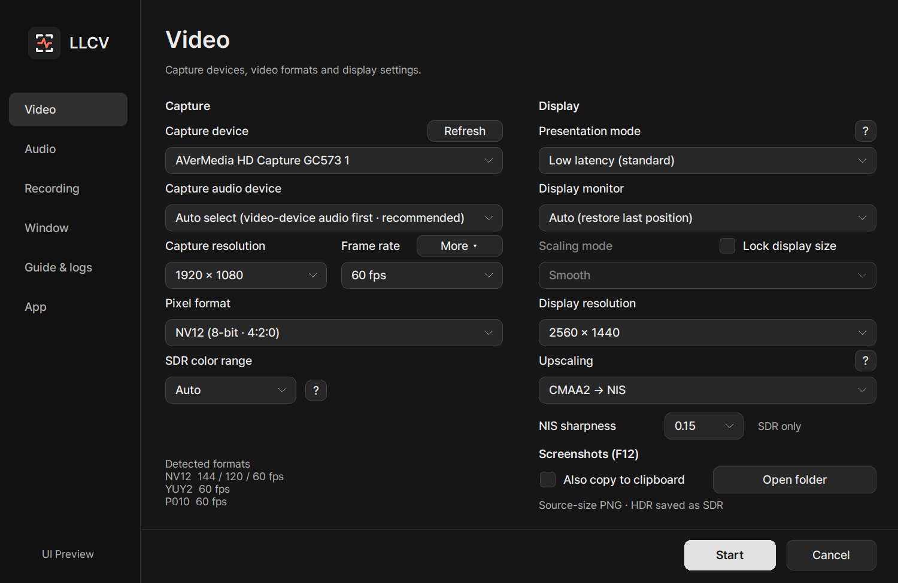
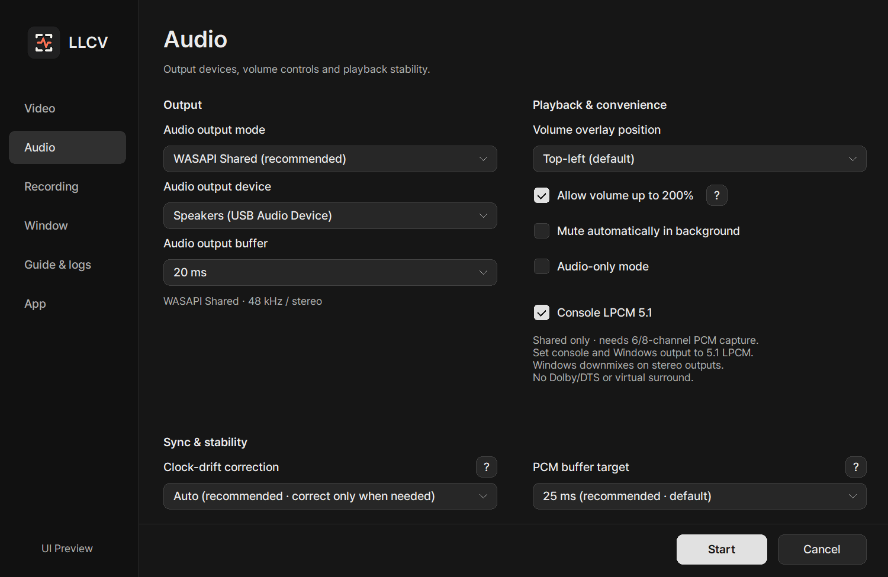
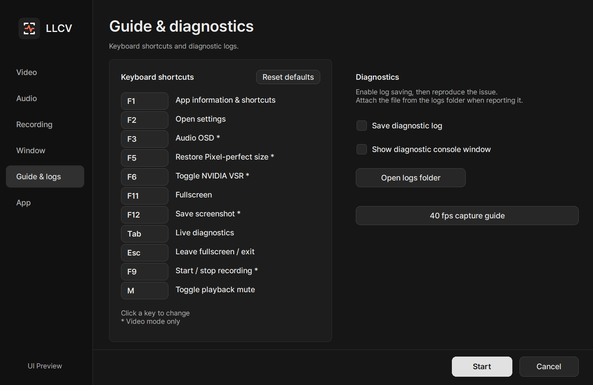

# LLCV user guide

[README](../README.en.md) · [Documentation](INDEX.md) · [한국어](USAGE.ko.md)

[Download](#download) · [First use](#first-use) · [Finding your settings](#finding-your-settings) · [What should I choose?](#what-should-i-choose) · [Changing shortcuts](#changing-shortcuts) · [Everyday controls](#everyday-controls) · [CMAA2 → NIS](#cmaa2--nis-upscaling) · [NVIDIA VSR (experimental)](#nvidia-vsr-experimental) · [Screenshots](#screenshots) · [Troubleshooting](#troubleshooting) · [Compatibility and feature requirements](#compatibility-and-feature-requirements)

 

## Download

Get one of the files from the [latest release](https://github.com/seria-aa/LowLatencyCaptureViewer/releases/latest):

- **Setup.exe — recommended:** installs the app and an uninstaller. A Start Menu
  shortcut is created automatically; the desktop shortcut is optional.
- **x64.zip — portable:** extract it, then run `LowLatencyCaptureViewer.exe`.

**2.1.9:** adds RGB24/XRGB SDR playback, source screenshots, VSR requests and recording, with conversion-headroom checks and bounded RGB recording buffers.
[Recording guide](RECORDING.md) · [2.1.9 release notes](release-notes-v2.1.9.md)
**40 fps capture**, added in [2.0.4](release-notes-v2.0.4.md),
remains off by default; enable it under **Video → More beside Frame rate** only when needed.
Sleep prevention and earlier settings improvements are covered in the
[2.0.3 release notes](release-notes-v2.0.3.md).
The earlier installer-only refresh is recorded in the [2.0.2 release notes](release-notes-v2.0.2.md).

Windows 10/11 x64 and a capture-device driver are required.

 

## First use

1. Close OBS, the vendor capture utility, and any other application using the
   capture device.
2. Start the app.
3. Confirm **Capture device**, then select **Start**.

The defaults are a good first test: 1080p, low-latency presentation, WASAPI
Shared, a 25 ms PCM buffer, and automatic clock-drift correction. A saved 20 ms
PCM target from an older build is upgraded to 25 ms once on first launch; other
saved values are preserved. You can select 20 ms again afterward.
Settings that already went through this migration are not changed again on update.

If video works but audio does not, check **Capture audio device**. USB capture
devices can expose separate video and audio devices; in that case, choose the
matching audio input manually. If the app shows “Internal audio detected · use
automatically,” no separate selection is needed.

 

## Finding your settings

Press **F2** in the viewer to return to **Video & window**, or **Audio** in audio-only mode.
Choose the **Recording** tab for recording options. While recording or paused, F2 asks
whether to finish the recording before returning to general settings: **Yes** saves and
returns to settings; **No** keeps playback and the current recording state.

*The following settings examples are rendered directly from the 2.1.6 UI code. Selections are illustrative; devices and supported formats/frame rates vary by setup.*

| Video settings | Audio settings |
| --- | --- |
|  |  |

### App information and shortcuts (default: F1)

Keyboard shortcuts, mouse controls, and screenshot help fit on one screen without scrolling.
The window stays inside the monitor work area, scaling its text and spacing together when space is limited.
Position and layout adapt to resolution/DPI changes and moves between monitors while the guide is open.

View the app information window

The sidebar separates **Video**, **Audio**, **Recording**, **Window**, **Guide & logs**, and **App**.
[Recording](RECORDING.md) contains codec, quality, size/rate limits, AAC, recording volume, splitting and storage settings.
Video contains capture/display settings and upscaling options. **More** next
to Frame rate contains unlisted FPS requests and 40 fps capture.
Audio contains output devices, buffers, volume options, audio-only mode, and LPCM 5.1.
Window controls placement, resizing, borders, and cursor behavior.
In App settings, **Release notes** opens the current app version's GitHub release
page in your browser, independently of manual or automatic update checks.
Guide & logs groups shortcut editing/reset, 40 fps guidance, logging and [report ZIP creation](DIAGNOSTICS.md#log-files); App contains language,
theme, startup, sleep prevention, update preferences, and screenshot options.

On small screens or at high display scales, settings fit within the desktop work
area. When space is limited, use the section selector at the top to access pages
of options without scrolling.

Choose **Dark** or **Light** under **App → App theme**. Settings, F1 help, and
the audio-only view share the theme. Overlays drawn over video remain dark for
contrast against the picture, regardless of the app theme.

Supported format/FPS combinations, internal capture audio, and WASAPI Shared
capabilities are queried in the background and reused while the settings window
remains open. **Refresh** requests a new query. Start remains
unavailable while the required video capabilities are being checked or could not be queried.
After changing device connections, refresh and confirm the selection if old information
remains. Switching between WASAPI and ASIO retains each backend's output device
and valid buffer choices.

**App → Prevent sleep during playback** is enabled by default. Video playback
requests that the screen and system stay awake; audio-only playback allows the
screen to turn off. Requests are released on playback end, capture errors, or
exit, and are not active while only the settings dialog is open. Explicit sleep,
lid-close actions, and Windows power policies take precedence. Requests are
restored when the user returns from sleep and playback continues, not on an
unattended automatic wake. This does not
change Windows power settings or disable screen savers or security locks.

 

## What should I choose?

### Video

| Setting | Good starting choice |
| --- | --- |
| Capture resolution | Start with **1920 × 1080**; this is the input size. |
| Display resolution | **Same as capture (new-profile default)** or a fixed size, independently of VSR. Fullscreen retains this size with black margins. Equal legacy capture/display sizes migrate to matching; different sizes remain fixed. |
| Pixel format | **Auto (NV12 preferred)** |
| Frame rate | **Auto**, or the source's actual output rate |
| 40 fps capture | **Off (default)**. Enable to request 40 fps instead of the normal frame-rate selection; support is checked at startup |
| Presentation | **Low latency (standard)** is the default for use alongside other apps. **Low latency (exclusive fullscreen)** may further reduce latency but limits use of other windows. **VSync (reduced tearing)** waits for refresh. **Compatibility (Blt + VSync)** uses an alternative output path, may add latency/GPU load, and does not support HDR10 |
| Display monitor | **Auto (restore last position)**; select a monitor to choose the startup location. A missing monitor falls back to the primary display; moving the window afterward is still allowed |
| Pixel-perfect / Lock display size | Locks the selected display size; 1:1 only when capture and display resolutions match. Turn off to resize manually |

A 120 fps capture mode does not create extra visual information when the game
does not output a new frame at that rate. Choose only frame rates that the
source and capture device actually support.

Enable **Allow unlisted FPS** to add **30 fps** when the driver does not list it.
This is off by default. Disabling it resets an unlisted 30 fps selection to Auto;
driver-listed 30 fps remains available. The separately colored **Direct request: 30 fps**
line below mode detection is not proof of support. This applies to the selected resolution/format,
not only QHD; enabling 40 fps capture takes precedence. Select 30 fps and **Start** to request it.
Rejection or a different applied rate stops startup with
a notice. This does not capture at 60 fps and drop frames in the app.

Disabling 40 fps capture restores the normal frame-rate selection. Unsupported
requests produce a startup error rather than silently falling back to another
FPS. This does not lock a game's FPS or replace VRR. Keep normal capture for
ordinary viewing. See the [40 fps capture guide](VIDEO.md#40-fps-capture)
for requirements and usage examples.

### Audio

| Setting | Good starting choice |
| --- | --- |
| Audio output mode | **WASAPI Shared** |
| Output device | **Follow the Windows default output device** |
| Output buffer | The value marked as recommended in settings |
| PCM buffer target | **25 ms** |
| Clock-drift correction | **Auto** |
| Console LPCM 5.1 | **Off (default)**. WASAPI Shared only; requires multichannel capture and playback equipment |

WASAPI Shared is the default mode for compatibility with other applications
and Windows effects. ASIO appears only when an ASIO driver
is installed. WASAPI Exclusive playback requires an output device that passes
the app's playback-event check. Use WASAPI Shared unless you have a specific
reason to choose another mode.

If sound occasionally breaks up, open the Tab diagnostics overlay. Raise the
PCM target in 5 ms steps from its current value (e.g. `20 → 25 → 30 ms`) only
when **buffer shortage** or **resampler output shortage** repeats.
Leave it alone when there are no errors.

### Using WASAPI Exclusive

Select **WASAPI Exclusive** as the audio output mode to check output devices
that have no saved result. Use an available device with an output buffer at
or above its verified minimum.

- Completed results are saved per device. Closing settings while other devices are still being checked retains results that have already completed.
- **Retry required** means the check could not establish compatibility, for example because the device was busy, disconnected, or had unstable timing. It does not trigger repeated automatic checks; inspect the device, then choose **Recheck all devices** to retry.
- Another device completing its check preserves the current device's valid output-buffer choice. Only invalid choices, such as a value below the verified minimum, are adjusted.
- Version 2.0.2 refreshes older probe records once. Results completed under the new criteria are reused across mode switches and launches.

Exclusive reserves the output device, which can limit simultaneous use by other
apps and bypass Windows audio effects. Console LPCM 5.1 requires **WASAPI Shared**.
See the [audio guide](AUDIO.md) for details.

### Using console LPCM 5.1

1. Set the console's audio output to **5.1 LPCM**.
2. Check that the capture card exposes **48 kHz 6-channel or 8-channel PCM**
   with a supported channel layout to the PC. **5.1 HDMI passthrough support alone is not sufficient.**
3. In the app's Audio tab, select **WASAPI Shared** and enable **Console LPCM 5.1**.
4. For actual 5.1 speaker playback, configure the Windows output device for **5.1 speakers** too.

Six-channel input is passed as 5.1; supported eight-channel input is mixed down
to 5.1. On stereo output devices, the Windows shared audio engine downmixes to
stereo. Dolby/DTS decoding, virtual surround, and ASIO/Exclusive 5.1 output are
not supported. Physical channel-by-channel listening validation is not yet
complete, so check speaker positions with the console's speaker test.
See the [audio guide](AUDIO.md) for channel-volume behavior and supported layouts.

### Listening without video

Enable **Audio-only mode** in the Audio tab to play capture audio without video
capture or presentation. Its dedicated view shows master/L/R volume, output
levels, and clipping status.

- **Scroll** over a master/L/R area to adjust volume; **double-click** to reset that volume to 100%.
- **Drag** inside the view to move it; drag an **edge** to resize at a fixed aspect ratio.
- The chosen window size is remembered for the next launch, and **Hide title bar** also applies.

Console LPCM 5.1 is available in audio-only mode when its requirements are met.
See the [audio-only guide](AUDIO.md) for details.

 

## Everyday controls

Keyboard shortcuts below and elsewhere in the guides use the **default bindings**.
If you change one, use your assigned key instead.

### Changing shortcuts

Playback mute was added in 2.1.3. If an existing profile already assigns M to another action, mute receives an unused function key.

1. Open **Settings → Guide & logs**, then click the key button beside an action.
2. Press a key, optionally with **Ctrl**, **Alt**, or **Shift**. Click the same
   button again to cancel key entry.
3. Choose **Start** to apply the changes. **Cancel** discards unapplied changes.

All eleven shortcuts can be changed, including **Leave fullscreen / Exit** (Esc).
None can be left empty. Duplicate bindings, modifier-only keys, Windows-key
combinations, and some reserved combinations such as Alt+F4 cannot be assigned.
**Reset defaults** restores all eleven; choose **Start** to apply the reset.

Help, settings, and OSD labels show the assigned keys, and longer combinations
expand the key column. Shortcuts act within LLCV, not globally in other apps.
Settings controls retain their normal navigation and editing keys.
While settings are open, Help and Recording shortcuts use only **F1–F24 except F4**,
with or without Ctrl/Alt/Shift. All valid assigned keys continue to work in the viewer.

View shortcut settings

### Default controls

| Default key / control | Action |
| --- | --- |
| `F2` | Open the default settings page (finish-recording confirmation when recording) |
| `Tab` | Show/hide live diagnostics |
| `F3` | Show/hide the audio meter over video (audio-only has its own view) |
| `F5` | Restore source-resolution 1:1 size (video mode) |
| `F6` | Toggle selected upscaling (video mode) |
| `F1` | App information and shortcuts (Help/Exit keys close only the help window while it is active) |
| `F12` | Save a source-resolution screenshot (video mode) |
| `F9` | Start / stop SDR/stereo recording during video playback |
| `M` | Toggle playback mute; recording volume is unaffected |
| `F11` | Toggle fullscreen (using the selected presentation mode) |
| `Esc` | Leave shortcut-enabled fullscreen; close the app in windowed or automatic-fullscreen mode |
| Mouse wheel over viewer | Change app volume in 5% steps |
| Mouse wheel over an L/R card | Change that channel only (show the meter with `F3` in video mode) |
| Double-click a master/L/R area in the audio-only view | Reset that volume to 100% |
| `Shift` + drag | Temporarily bypass edge snap |

**Pixel-perfect / Lock display size** keeps the selected display size. Matching capture and display
resolutions gives 1:1 pixels; turn this off to resize the window while retaining aspect ratio.
Borderless and exclusive fullscreen retain the selected display size with black margins.
Choose **Fullscreen video position** under **Window** for center/edge positioning. Oversized video
is fitted without cropping. F5 restores input size, while F6 toggles only the selected upscaling method.

**Hide title bar** removes windowed-mode borders and is separate from `F11`
fullscreen. **Keep relative window size when moving monitors** maintains similar
screen coverage across monitors. It is independent of Pixel-perfect, so press
`F5` if you need exact 1:1 sizing after a move. F5 also resets the relative-size
baseline to the restored capture-sized window, including when VSR's display size
differs. The window position is saved; closing while minimized retains the position
the window would restore to. Edge snap can be enabled or disabled and
uses the same edge-distance threshold for snapping and releasing; hold Shift to bypass it.

**Since 2.0.1:** **Window → Rounded corners (Windows 11)** uses the same standard
system-drawn radius for regular/borderless video and audio-only windows (default
ON, saved between launches). Regular windows retain their system border; only
borderless windows hide the DWM outline while rounding is enabled.
Maximized and fullscreen windows stay square.
Turn it off to retain every corner pixel. It does not rescale video or add an
app-side mask/render pass; unsupported systems keep their existing appearance.
Windows may suppress rounding in snapped/remote environments; see
[Microsoft's rounding policy](https://learn.microsoft.com/en-us/windows/apps/desktop/modernize/ui/apply-rounded-corners).

Use the **speaker button** in the audio OSD (`F3`) or audio-only view to mute playback.
Unmuting restores the previous volume; adjusting volume with the wheel or resetting a volume also unmutes.
Recording volume is unaffected. Mute state resets when the app exits.
A translucent icon remains at the top-right of the video when muted with the audio OSD hidden; it is not recorded.

Enable **Allow volume boost above 100%** in audio settings to raise master volume
up to 200%. Individual L/R volume is capped at 100%; boosting loud input can
cause clipping. **Background auto-mute** silences output while another window
is active without stopping capture. The audio meter's position over video is
also configurable.
When boost is enabled, the audio-only view and F3 meter indicate the 200% maximum;
master values above 100% also use orange in those views and the volume notification.
The clipping warning is separate from this boost indication.

In fullscreen, the cursor hides after two seconds of inactivity and reappears
when you move the mouse or scroll. Choose **Always show** on the **Window**
page if you prefer a visible cursor.

Enable **Start directly next time** to skip the settings window. Hold `Shift`
while launching, or press `F2` from the viewer, to open it again.
After an update, settings are shown once on the first launch. Your immediate-start
preference is retained and applies again on the next launch after closing settings.
Cancel also counts as the one-time display. If the acknowledgement cannot be saved, settings are shown again on the next launch.

Use **Language** on the **App** page to follow the Windows language or explicitly choose
Korean or English. The same page offers automatic update checks after startup
(enabled by default) and manual checks. It does not install updates
automatically; accepting the prompt opens the installer link in your browser.

 

## CMAA2 → NIS upscaling

Under **Video → Upscaling**, below **Display resolution**, select **Off / CMAA2 → NIS / NVIDIA VSR**.
CMAA2 smooths SDR edges at source size before NIS enlargement. HDR10 is shown as **NIS (HDR10)** and skips CMAA2. Sharpness defaults to **0.15**
and is adjustable from 0.00 to 1.00. Existing VSR preferences are preserved; the new filter is opt-in.

- SDR NV12/YUY2/UYVY/decoded MJPEG/RGB and P010 HDR10; enlargement up to 2× on each axis.
- HDR10 runs NIS alone, retaining PQ/BT.2020 and bounding excessive contour changes against the original bilinear image. Method, correction and sharpness are retained across SDR/HDR transitions.
- Native size, downscaling and enlargement beyond 2× use the original path. Increase display size if it currently matches capture.
- Display only: OSD is drawn afterward; recordings and screenshots retain the capture source.
- Mutually exclusive with VSR. F6 toggles the selected method without switching it. NIS sharpness is retained when toggling off and on.
- Selecting Off in settings also remembers the last method. With no selection history, F6 enables CMAA2 → NIS (default sharpness 0.15). Startup still defaults to Off.
- Older profiles with VSR enabled retain VSR selection. Older profiles saved with upscaling already off have no last-method record and are treated as having no selection history.
- Additional GPU work is required. Select Off for the lowest processing cost.

For example, with **1920 × 1080** capture, choose **2560 × 1440** display resolution and
**CMAA2 → NIS**. **CMAA2 correction** and **NIS sharpness** appear side by side below only when this method is selected.
CMAA2 correction applies only to SDR. Selecting P010 disables that field without changing its saved value; switching back to SDR restores it.
**High** smooths more edges; **Preserve** retains more of the original text and thin-line shapes.
0.00 minimizes sharpening; it does not disable the filter.
The adjacent **?** button explains the requirements of both upscaling methods.

 

## NVIDIA VSR (experimental)

**Since 2.0.1:** HDR10/YUY2 + VSR support below is not included in v2.0.0.

At startup, the viewer checks its default D3D11 rendering adapter once, before
showing settings. On Intel/AMD or an unidentified adapter, VSR is disabled; capture and display
resolution choices remain available; F6 cannot enable it. Identification failure has a separate
message. This vendor check does not certify RTX support or actual enhancement,
does not change GPU selection, and is not repeated on tab changes or per frame.

Select **NVIDIA VSR** under **Video → Upscaling**; the adjacent **?** button opens the setup guide.
The default is Off. The remembered method and enable state changed with F6 are saved on normal
exit. Supported viewer routes are NV12/YUY2 SDR, MJPEG decoded to NV12, and P010 HDR10
displayed at the source size or larger. Same-size output can request native-resolution
de-artifacting. **Capture resolution** selects the input, while **Display resolution** independently
selects the video size, whether VSR is on or off. **Lock display
size** keeps that selected window size; disable it for manual resizing. F6 changes
only the effect, without restarting capture or changing either resolution. F5
restores source-size display. Detected formats/FPS and screenshots follow the input
resolution. YUY2 uses the existing processor directly, with no extra app-side conversion pass.
Downscaling in either dimension bypasses VSR. Capture resolutions
include 1280x720, 1920x1080, 2560x1440 and 3840x2160, subject to device support.

For native HDR, select **P010** and keep the usual HDR10/Windows HDR setup.
The existing P010 → 10-bit BT.2020/PQ output is retained; no SDR intermediate or
RTX Video HDR (SDR-to-HDR conversion) is enabled. Use a recent NVIDIA driver:
[NVIDIA added HDR VSR upscaling in January 2025](https://nvidia.custhelp.com/app/answers/detail/a_id/5448/).
If a driver accepts the VSR request but cannot process the frame, the viewer
turns VSR off and retries that frame once, preserving the HDR route. The request
status reports rejection; ordinary HDR rendering errors are not suppressed.

For example, choose **Capture resolution: 1920 × 1080** and **Display resolution: 2560 × 1440**
for 1080p capture in a 1440p-sized window. Choose 1920 × 1080 for both to request
same-size processing. These options configure the viewer/capture path; they do
not change the console's HDMI output mode or the monitor's desktop resolution.

**Tab** shows VSR ON/OFF and input → displayed video size.
ON means the feature is enabled in the viewer, not that driver activation has been detected. Rejected, unavailable,
and failed/unknown states are distinguished. No VSR-added-latency number is shown:
CPU call time is not equivalent to actual added display latency.

**Setup guide** explains how to enable VSR; it does not run a GPU test or claim
compatibility or activation. Enable RTX Video Super Resolution and check its active indicator in
[NVIDIA App / Control Panel](https://nvidia.custhelp.com/app/answers/detail/a_id/5448).
The viewer does not change NVIDIA profiles or add a frame queue/wait to match
ON/OFF latency. VSR processing can increase latency and GPU use. Screenshots
remain source images without VSR.

 

## Screenshots

Press **F12** during video playback to save a PNG in **Pictures / LowLatencyCaptureViewer**.
The screenshot section of **App** has **Open folder** and
**Also copy to clipboard** (off by default).

**F1** opens a modeless guide with the app version, keyboard shortcuts, mouse controls,
and screenshot information without stopping playback.
Use the configured Help or Exit key (defaults: F1/Esc), or its Close button, to
dismiss it. The Exit key here closes only the help window, not the viewer.

- NV12/YUY2 and decoded MJPEG retain the capture resolution and selected SDR color interpretation.
- P010 HDR10 is converted to **SDR sRGB**, both in the PNG and clipboard image.
  This is not an HDR-preserving export. Highlights and wide-gamut colors are compressed;
  appearance will not be identical to HDR playback. Tone mapping uses a fixed 203-nit
  reference, independent of Windows HDR brightness settings. After gamut conversion,
  max-RGB levels through 100 nits retain their linear brightness; a smooth shoulder
  compresses brighter levels instead of dimming the entire range. This fixed export
  curve is not scene-adaptive or an exact reproduction of OBS's tone mapping.
- Captures exclude OSD, window borders, scaling and Sharp/CMAA2 → NIS/VSR display processing.
- One request is processed at a time. Source data is copied once into owned memory;
  conversion, clipboard publication, and PNG encoding run on a lower-priority worker.
  Clipboard publication precedes file encoding, but conversion still takes time.
- A busy clipboard does not prevent file saving. Closing the viewer cancels pending work;
  wait for the completion notice if you need the screenshot. Photos already saved are retained.

 

## Troubleshooting

| Problem | Try this first |
| --- | --- |
| No video | Close OBS/vendor tools, check the capture device and supported resolution, then choose Auto pixel format |
| 40 fps capture will not start | Disable the option and retry the normal rate. Support depends on the device, resolution, and format; see [40 fps troubleshooting](TROUBLESHOOTING.md#40-fps-capture-will-not-start) |
| Monitor briefly loses signal in Low latency mode | The graphics driver may be incompatible with the tearing presentation path. Change Presentation to **VSync**; borderless mode can remain enabled |
| No audio | Check playback mute/volume, then select the audio input that belongs to the video device |
| Occasional audio breakup | Check for buffer shortage in Tab diagnostics, then raise the PCM target in 5 ms steps and test again |
| Exclusive shows retry required | Check the device connection and whether another app is using it, then select **Recheck all devices**. Use WASAPI Shared to resume playback without an Exclusive check |
| Playback stops with a device-error message | Check connections and other capture apps, then confirm the device in settings and start again. Devices are not repeatedly reconnected automatically |
| Settings could not be saved | Check write access, free space, and file locks at the path shown. Previous settings are preserved; changes that failed to save may not survive the next launch |
| VSR appears to have no effect | Check NV12/YUY2/UYVY/MJPEG/RGB SDR or P010 HDR10 input, a supported NVIDIA rendering GPU/driver, native-size or larger output, the Tab state, and NVIDIA's active indicator; a successful request alone does not confirm activation |
| Need more evidence | Enable logging in Guide & logs, reproduce the issue, then send the newest `.log` file from **Open log folder** together with screenshots of settings and Tab diagnostics |

Settings and optional logs are stored in `%LOCALAPPDATA%\LowLatencyCaptureViewer`.
The uninstaller can remove this user data on request. Data is retained if the
running account and target path cannot be verified safely.
When the capture source explicitly completes all streams, the viewer returns to
settings. Temporary loss of signal alone is not treated as normal completion.
See [troubleshooting](TROUBLESHOOTING.md) for recovery steps.

 

## Compatibility and feature requirements

AVerMedia GC573 is the primary development and test device. Other DirectShow
capture devices are supported, but driver differences mean that every model
cannot be guaranteed.

- Standard support: compatible 48 kHz mono/stereo PCM or 32-bit float input, and progressive NV12/YUY2 video
- **SDR color range**: Auto / Limited / Full, shared by playback, screenshots and recording; not applied to P010/HDR.
- Compatibility mode: MJPEG, always listed for manual selection when the device
  exposes it, with automatic decoder-metadata-based range and BT.601/709 handling.
  If needed, select BT.709/BT.601 under **MJPEG matrix** and the range under the
  common **SDR color range** control.
- HDR10 requires supported P010 input and an HDR-capable display/output path; ASIO requires a compatible installed driver.
- Console LPCM 5.1 requires 48 kHz multichannel PCM capture and WASAPI Shared output.
- Experimental: NVIDIA VSR
- Not supported: H.264/AVC, MPEG-4, automatic device reconnect

### Viewing HDR

Enable HDR on the source, select **P010 10-bit HDR10**, and enable **Windows HDR
on the monitor displaying the app**. Use low latency or VSync presentation.
An HDR passthrough display does not by itself mean the PC view is also HDR.

- P010 is **HDR-only** in this app. For normal SDR input, choose Auto or NV12/YUY2.
- P010 without color information is **assumed to be PQ/BT.2020 HDR10**. This is not detection of actual HDR content.
- Use **Force HDR10** only when the input really is HDR10 but the device reports incorrect color information.
  Missing information alone does not require it, and it does not convert SDR to HDR.
- **HDR chroma placement** defaults to Auto. Manual Left/Top-left choices are compatibility
  overrides for incorrect placement information; read the [HDR guide](VIDEO.md) first.
- Supported AVerMedia/Elgato devices receive capture-format-aware internal tone-mapping
  requests at startup. This does not guarantee support for every model or actual HDR delivery.

HDR10 requires PQ/BT.2020 Limited input and a supported GPU output path.
HLG, Full-range HDR, HDR through Compatibility (Blt), and app-provided HDR-to-SDR
display conversion are not supported. Tab diagnostics show the current
display's HDR status; actual brightness and colors can vary by capture device
and monitor.

---

[README](../README.en.md) · [Documentation](INDEX.md) · [한국어](USAGE.ko.md)
